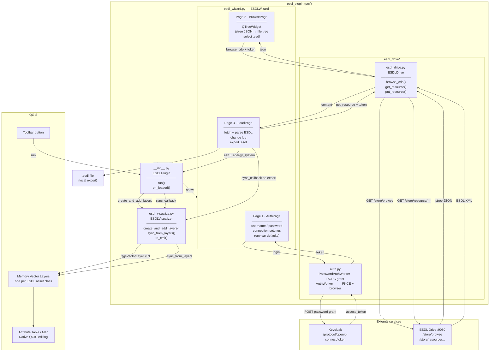

## Development setup

```
# Run once in an elevated PowerShell
$qgisPlugins = "C:\Users\wangck\AppData\Roaming\QGIS\QGIS3\profiles\default\python\plugins"
New-Item -ItemType SymbolicLink -Path "$qgisPlugins\esdl_plugin" -Target "C:\Users\wangck\projects\playground\QGIS - DTK\plugin\src"
```


