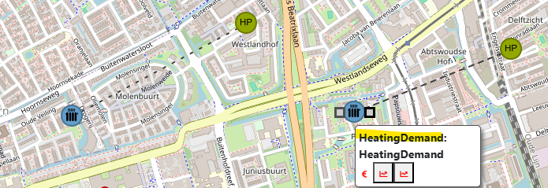

# ESDL QGIS Plugin

Load, visualize, and edit [ESDL](https://energytransition.github.io/) energy system files directly in QGIS.

## Installation

### Install Python dependencies

The plugin requires `pyESDL` and its dependencies. Install them using the **OSGeo4W Shell** (shipped with QGIS — search for it in the Start Menu):

```bat
pip install pyESDL
```

### Restart QGIS

After installing the dependencies, restart QGIS and enable the plugin via **Plugins → Manage and Install Plugins**.

---

## Development setup

```
# Run once in an elevated PowerShell
$qgisPlugins = "C:\Users\wangck\AppData\Roaming\QGIS\QGIS3\profiles\default\python\plugins"

New-Item -ItemType SymbolicLink -Path "$qgisPlugins\ESDL-QGIS-Plugin" -Target "C:\Users\wangck\projects\github\ESDL-QGIS-Plugin\src"
```

# TODOs

2026-06-11

- [ ] Pack required packages in the plugin
- [ ] Add License file and add license field in metadata.txt
- Should the plugin support loading multiple ESDLs? --> No for now.
- [ ] Review if import statement can be hoisted to top from fn level.
- Function argu should have type hint e.g. esdl.Area

- [ ] Have a way to refresh connection lines when asset is moved.
  - [v] Understand what are the options there.
    - QGIS native topology tools (Settings → Snapping → Topological editing) only work within the same layer, not across layers.
    - The implementation of live update of connection line is doable, but can be expensive.
    - Possible workaround is to have a Connection refresh btn to update the visualization of connection line.
- [v] Add hierarchy to asset options
  - either grouped by asset capability or recent / generic
  - [] Return empty list in fallback at list_asset_classes() in esdl_model.py
- [v] Check if attribue options support getting ENUM values
- [v] Use ESDL icon on feature.
  - [] Should ESDL icon be published as a library?

2026-07-01

- [v] Refine port connection UX/UI
  - Also added Delete Connection
- [v] Set carrier on port? --> implemented with ESDL browser
- [v] Asset handling with ESDL browser;
  - [v] Also used for asset editing
- [v] Delete asset button
- [ ] Move asset button

- [WIP] Table editor with costInformation support
  - Should this be implemented as special module for future maintainability?

- [v] Remove layer group after the pulgin exit
- [] Add id suffix to asset name

  

- [v] Quick load performance test on a large 'NWN' ESDL

- [ ] Fully architecture cleanup
  - Assess the current implementation and components, reorganize codebase based for modularity design.

- [ ] How the whole plugin is ESDL model compatible? If ESDL model change, will thing work properly after dependency update?. Make sure to document well the custom part

Bug

- [ ] selector buffer, sometimes not very precise (e.g. clicking on port, but a pipe is selected)
- [ ] Cancel Add/Edit/Delete action is not straightforward (cursor remains a + sign)
- [ ] Handling QGIS crash
- [ ] Handle editing in projected CRS

2026-07-16
- [ ] Connecting line (pipe) asset on edge instead of centroid 
- [ ] Add Test


TBD:

- How is number of asset ports defined? e.g. HeatingDemand, what should be the default # of ports?
- Should ESDL icon be published as a library?
